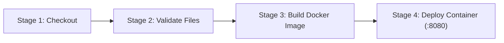

# Royal Marigold — Fine Dining Restaurant Website & DevOps Pipeline

A simple, elegant, and premium-looking restaurant website built with a luxury **Black, Silver, and Marigold Gold** colour palette. This project is configured as an end-to-end beginner-friendly college DevOps demonstration utilizing **Git, GitHub, Docker, and Jenkins CI/CD**.

---

## 1. Project Overview & Features

* **Multi-Page Fine Dining Website**: Includes **Home**, **About Us**, **Menu Categories**, **Reach Us**, and an **Admin Portal**.
* **Premium Royal Palette**: Black (`#101010`), Charcoal (`#1A1A1A`), Silver (`#C0C0C0`), and Marigold Gold (`#EAAE00`).
* **Dynamic Menu Filtering**: Instant category filtering between *All*, *Starters*, *Main Course*, *Biryani*, *Desserts*, and *Beverages*.
* **Admin Management Panel**: Allows kitchen managers to add new dishes with client-side validation (positive price check, required fields) and instant persistence across page refreshes via browser `localStorage`.
* **Lightweight & High-Performance**: Built purely with semantic HTML5, modern responsive CSS3, and vanilla JavaScript without heavy external libraries or databases.
* **Production-Grade Containerization**: Encapsulated in an official `nginx:alpine` Docker container.
* **Automated CI/CD Pipeline**: Declarative Jenkins pipeline automating source code checkout, file validation, Docker image compilation, and automated container deployment.

---

## 2. Colour Palette Specification

| Role | Colour Name | Hex Code | Purpose |
| :--- | :--- | :--- | :--- |
| **Primary Black** | Dark Obsidian | `#101010` | Dominant backgrounds (Nav, Hero, Body, Footer) |
| **Secondary Black** | Charcoal Black | `#1A1A1A` | Menu cards, admin panels, contact tiles |
| **Silver** | Classic Silver | `#C0C0C0` | Secondary descriptions, subtle borders, inactive buttons |
| **Light Silver** | Platinum Silver | `#E5E5E5` | Body readability text, accent labels |
| **Marigold Gold** | Rich Marigold | `#EAAE00` | Headings, active buttons, prices, icons, accents |
| **Deep Marigold** | Burnt Marigold | `#C98B00` | Hover states, button focus rings |
| **White** | Crisp White | `#FFFFFF` | Primary dish names and hero titles |

---

## 3. Technology Stack

* **Frontend**: HTML5, CSS3, Vanilla JavaScript (ES6+)
* **Web Server**: Nginx (Alpine Linux)
* **Version Control**: Git & GitHub
* **Containerization**: Docker
* **CI/CD Automation**: Jenkins (Declarative Pipeline)

---

## 4. Project File Structure

```text
restaurant-website/
├── index.html        # Home page (Hero, logo, introduction, culinary highlights)
├── about.html        # About Us page (History, dining philosophy, atmosphere)
├── menu.html         # Interactive menu with dynamic category filters
├── reach-us.html     # Contact details, business hours, and Google Maps embed
├── admin.html        # Frontend demonstration admin panel to add new dishes
├── style.css         # Unified stylesheet with luxury Black & Marigold theme
├── script.js         # Navigation, localStorage state, menu filtering, and admin logic
├── Dockerfile        # Docker build recipe using nginx:alpine
├── Jenkinsfile       # Declarative 4-stage CI/CD pipeline
├── .gitignore        # Git ignore exclusions
├── .dockerignore      # Docker context ignore exclusions
└── README.md         # Comprehensive project documentation
```

---

## 5. Running the Website Locally (Without Docker)

Because the project is built with lightweight vanilla web standards, you can preview it immediately without installing any backend:

1. Clone or navigate to the project directory:
   ```bash
   cd restaurant-website
   ```
2. Open `index.html` directly in any web browser (Chrome, Edge, Firefox, Safari):
   * On Windows: Double-click `index.html` or run:
     ```powershell
     Start-Process index.html
     ```
   * Or run a simple local web server using Python (optional):
     ```bash
     python -m http.server 3000
     ```
     Then open `http://localhost:3000`.

---

## 6. Git & GitHub Version Control Workflow

Follow these steps to initialize and push this project to your GitHub account:

### Step 1: Initialize Git Repository
```bash
git init
git add .
git commit -m "Initial commit: Royal Marigold Restaurant website with Docker & Jenkinsfile"
```

### Step 2: Create a Repository on GitHub
1. Go to [GitHub.com](https://github.com) and click **New Repository**.
2. Name it `restaurant-website`.
3. Keep it **Public** (or Private) and leave README unchecked.

### Step 3: Link and Push
```bash
git branch -M main
git remote add origin https://github.com/<your-username>/restaurant-website.git
git push -u origin main
```

---

## 7. Docker Integration & Commands

The project includes an optimized `Dockerfile` based on `nginx:alpine` that copies the web assets into `/usr/share/nginx/html` and serves them over port 80.

### Step 1: Build the Docker Image
```bash
docker build -t restaurant-website .
```

### Step 2: Run the Docker Container
Run the container mapping host port **8080** to container port **80**:
```bash
docker run -d -p 8080:80 --name restaurant-website-app restaurant-website
```

### Step 3: Access the Website
Open your browser and navigate to:
```
http://localhost:8080
```

### Step 4: Stop and Remove Container
To stop the running application:
```bash
docker stop restaurant-website-app
```
To remove the stopped container:
```bash
docker rm restaurant-website-app
```
To view container status:
```bash
docker ps -a
```

---

## 8. Jenkins CI/CD Pipeline Setup

The included `Jenkinsfile` defines a 4-stage pipeline that automates the delivery process:



### Pipeline Stages
1. **Checkout**: Clones the latest branch commit from GitHub.
2. **Validate**: Checks that all critical assets (`index.html`, `about.html`, `menu.html`, `reach-us.html`, `admin.html`, `style.css`, `script.js`, `Dockerfile`) exist before proceeding. If any file is missing, the build terminates with a clear failure.
3. **Build**: Builds `restaurant-website:latest` using Docker.
4. **Deploy**: Gracefully stops any previously running `restaurant-website-app` container and runs the new image mapped to host port **8080**.

### Jenkins Prerequisites
1. Jenkins server installed with Docker installed on the same host (or agent).
2. Jenkins user added to the `docker` group so it can execute Docker commands:
   ```bash
   sudo usermod -aG docker jenkins
   sudo systemctl restart jenkins
   ```
3. Recommended Jenkins plugins installed:
   * **Git plugin**
   * **Pipeline plugin**

### How to Create the Jenkins Pipeline Job
1. Open Jenkins (`http://localhost:8080` or your Jenkins URL).
2. Click **New Item** &rarr; Enter name: `restaurant-website-pipeline` &rarr; Select **Pipeline** &rarr; Click **OK**.
3. Under the **Pipeline** configuration section:
   * **Definition**: Select *Pipeline script from SCM*.
   * **SCM**: Select *Git*.
   * **Repository URL**: Paste your GitHub repository URL (e.g., `https://github.com/<your-username>/restaurant-website.git`).
   * **Branch Specifier**: `*/main`
   * **Script Path**: `Jenkinsfile`
4. Click **Save**.
5. Click **Build Now** to trigger the pipeline.
6. Verify stages in the **Stage View** and visit `http://localhost:8080` once complete.

---

## 9. Admin Panel Authentication & Management

* **Login Protection**: Access to the Admin Dashboard is protected with credentials:
  * **Username**: `spenza`
  * **Password**: `spenza123`
* Once authenticated, session state is preserved in browser `sessionStorage`, and an elegant **Logout** option is provided in the top bar.
* **Add Menu Items**: Food items added through the admin form are persisted into the browser's `localStorage` and dynamically appended to the menu items array.
* Newly added items automatically reflect in both the Admin listing table and the main `menu.html` page under their designated category.
* **Demonstration Notice**: This demonstration is built for a college DevOps curriculum. In a real-world enterprise production deployment, credentials and authentication would be validated by a backend service (e.g. JWT/OAuth/database) rather than frontend logic.

---

## 10. License & Credits

* Developed for College DevOps Laboratory Demonstration.
* High-resolution culinary imagery provided via [Unsplash](https://unsplash.com).
* Typography: *Cinzel* & *Montserrat* via Google Fonts.
