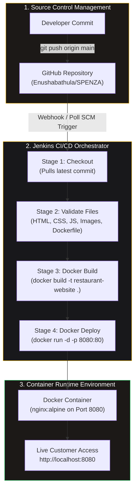
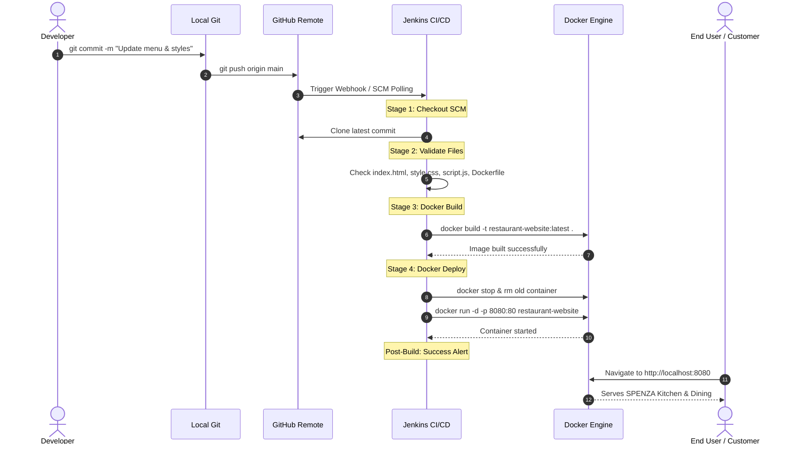

# SPENZA Kitchen & Dining — Restaurant Website & DevOps Pipeline

A simple, elegant, and premium-looking down-scrolling restaurant website for **SPENZA Kitchen & Dining** (*"Crafted for the Finest Tastes."*), built with a luxury **Wine Red (`#7F011F`), Light Sand (`#F5EBD0`), and Black** colour palette. This project is configured as an end-to-end beginner-friendly college DevOps demonstration utilizing **Git, GitHub, Docker, and Jenkins CI/CD**.

---

## 1. Project Overview & Features

* **Brand Identity**: **SPENZA Kitchen & Dining** with official emblem logo, tagline *"Crafted for the Finest Tastes."*, and direct reservation line (`+91 832 859 4373`).
* **Operating Hours**: Open all week (Monday &ndash; Sunday) from **12:00 PM to 12:00 AM**.
* **Seamless Down-Scrolling Experience**: Pure single-page smooth down-scrolling architecture (`#home`, `#about`, `#menu`, `#reach-us`) allowing visitors to scroll naturally without page reload tapping.
* **Authentic Interior Background**: High-resolution restaurant dining hall photo (`hero-bg.jpg`) showcased as the hero backdrop.
* **Wine Red & Light Sand Palette**:
  * **Wine Red**: `#7F011F` (CTA buttons, active category pills, borders, highlights)
  * **Light Sand**: `#F5EBD0` (Headings, readable text, badge accents, prices)
  * **Deep Obsidian**: `#101010` & Charcoal `#161616` (Refined dark dining ambience)
* **Protected Admin Portal**: Dedicated login requiring credentials (`spenza` / `spenza123`) to add dishes with client-side validation and persistence in browser `localStorage`.
* **Dynamic Menu Filtering**: Instant category filtering between *All*, *Starters*, *Main Course*, *Biryani*, *Desserts*, and *Beverages*.
* **Production-Grade Containerization**: Encapsulated in an official `nginx:alpine` Docker container.
* **Automated CI/CD Pipeline**: Declarative Jenkins pipeline automating source code checkout, file validation (including logo, interior background, and assets), Docker image compilation, and automated container deployment.

---

## 2. Colour Palette Specification

| Role | Colour Name | Hex Code | Purpose |
| :--- | :--- | :--- | :--- |
| **Wine Red** | Royal Bordeaux | `#7F011F` | CTA buttons, category active states, borders, brand badge |
| **Deep Wine** | Dark Maroon | `#5A0015` | Button hover states, glowing interactive highlights |
| **Light Sand** | Warm Sand | `#F5EBD0` | Main headlines, food prices, contrast text, brand title |
| **Sand Gold** | Sand Gold Muted | `#E8D5B0` | Taglines, secondary subheadings |
| **Primary Black** | Dark Obsidian | `#101010` | Dominant body, navigation, and section backgrounds |
| **Secondary Black** | Charcoal Black | `#161616` | Menu cards, highlight boxes, contact tiles |
| **White** | Crisp White | `#FFFFFF` | Food item titles and hero headline |

---

## 3. Technology Stack

* **Frontend**: HTML5, CSS3, Vanilla JavaScript (ES6+)
* **Web Server**: Nginx (Alpine Linux)
* **Version Control**: Git & GitHub
* **Containerization**: Docker
* **CI/CD Automation**: Jenkins (Declarative Pipeline)

---

## 4. Project File Structure

```text
restaurant-website/
├── index.html        # Single-page down-scrolling site (Hero, About, Menu, Reach Us)
├── about.html        # Dedicated About Us view
├── menu.html         # Dedicated Menu view
├── reach-us.html     # Dedicated Reach Us view
├── admin.html        # Protected admin portal (login spenza/spenza123 + add dish form)
├── logo.png          # Official circular SPENZA emblem logo
├── hero-bg.jpg       # Authentic SPENZA restaurant interior photo for hero backdrop
├── style.css         # Unified stylesheet with Wine Red & Light Sand theme
├── script.js         # Navigation, auth, localStorage state, and menu filtering
├── Dockerfile        # Docker build recipe using nginx:alpine
├── Jenkinsfile       # Declarative 4-stage CI/CD pipeline
├── .gitignore        # Git ignore exclusions
├── .dockerignore      # Docker context ignore exclusions
└── README.md         # Comprehensive project documentation
```

---

## 5. Running the Website Locally (Without Docker)

Because the project is built with lightweight vanilla web standards, you can preview it immediately without installing any backend:

1. Clone or navigate to the project directory:
   ```bash
   cd restaurant-website
   ```
2. Open `index.html` directly in any web browser (Chrome, Edge, Firefox, Safari):
   * On Windows: Double-click `index.html` or run:
     ```powershell
     Start-Process index.html
     ```
   * Or run a simple local web server using Python (optional):
     ```bash
     python -m http.server 3000
     ```
     Then open `http://localhost:3000`.

---

## 6. Git & GitHub Version Control Workflow

Follow these steps to initialize and push this project to your GitHub account:

### Step 1: Initialize Git Repository
```bash
git init
git add .
git commit -m "Initial commit: Royal Marigold Restaurant website with Docker & Jenkinsfile"
```

### Step 2: Create a Repository on GitHub
1. Go to [GitHub.com](https://github.com) and click **New Repository**.
2. Name it `restaurant-website`.
3. Keep it **Public** (or Private) and leave README unchecked.

### Step 3: Link and Push
```bash
git branch -M main
git remote add origin https://github.com/<your-username>/restaurant-website.git
git push -u origin main
```

---

## 7. Docker Integration & Commands

The project includes an optimized `Dockerfile` based on `nginx:alpine` that copies the web assets into `/usr/share/nginx/html` and serves them over port 80.

### Step 1: Build the Docker Image
```bash
docker build -t restaurant-website .
```

### Step 2: Run the Docker Container
Run the container mapping host port **8080** to container port **80**:
```bash
docker run -d -p 8080:80 --name restaurant-website-app restaurant-website
```

### Step 3: Access the Website
Open your browser and navigate to:
```
http://localhost:8080
```

### Step 4: Stop and Remove Container
To stop the running application:
```bash
docker stop restaurant-website-app
```
To remove the stopped container:
```bash
docker rm restaurant-website-app
```
To view container status:
```bash
docker ps -a
```

---

## 8. Jenkins CI/CD Pipeline Flow & Automation

The included `Jenkinsfile` orchestrates an automated Declarative CI/CD pipeline that connects **Git, GitHub, Docker, and Jenkins** in a unified delivery lifecycle:

### Visual Pipeline Flowchart



### End-to-End Sequence Diagram



### Detailed Pipeline Stages

1. **Stage 1: Checkout**:
   * Uses `checkout scm` to pull the latest source code revisions directly from the GitHub repository into the Jenkins isolated workspace.
2. **Stage 2: Validate**:
   * Executes a fail-fast pre-flight integrity check on required website assets (`index.html`, `about.html`, `menu.html`, `reach-us.html`, `admin.html`, `style.css`, `script.js`, `logo.png`, `hero-bg.jpg`, `Dockerfile`).
   * If any file is accidentally missing or renamed, the build terminates early before consuming Docker resources.
3. **Stage 3: Build**:
   * Compiles the container image with `docker build -t restaurant-website:latest .`.
   * Packages Nginx Alpine with all restaurant static assets.
4. **Stage 4: Deploy**:
   * Inspects if any existing container named `restaurant-website-app` is currently running.
   * Gracefully terminates and removes the legacy container (`docker stop`, `docker rm`).
   * Starts a fresh container mapping host port **8080** to internal Nginx port **80** (`docker run -d -p 8080:80 ...`).
5. **Post Actions**:
   * Prints the deployment status banner, verified URL (`http://localhost:8080`), and image metadata. Logs failure diagnostics if any stage fails.

### Jenkins Prerequisites
1. Jenkins server installed with Docker installed on the same host (or agent).
2. Jenkins user added to the `docker` group so it can execute Docker commands:
   ```bash
   sudo usermod -aG docker jenkins
   sudo systemctl restart jenkins
   ```
3. Recommended Jenkins plugins installed:
   * **Git plugin**
   * **Pipeline plugin**

### How to Create the Jenkins Pipeline Job
1. Open Jenkins (`http://localhost:8080` or your Jenkins URL).
2. Click **New Item** &rarr; Enter name: `restaurant-website-pipeline` &rarr; Select **Pipeline** &rarr; Click **OK**.
3. Under the **Pipeline** configuration section:
   * **Definition**: Select *Pipeline script from SCM*.
   * **SCM**: Select *Git*.
   * **Repository URL**: Paste your GitHub repository URL (e.g., `https://github.com/<your-username>/restaurant-website.git`).
   * **Branch Specifier**: `*/main`
   * **Script Path**: `Jenkinsfile`
4. Click **Save**.
5. Click **Build Now** to trigger the pipeline.
6. Verify stages in the **Stage View** and visit `http://localhost:8080` once complete.

---

## 9. Admin Panel Authentication & Management

* **Login Protection**: Access to the Admin Dashboard is protected with credentials:
  * **Username**: `spenza`
  * **Password**: `spenza123`
* Once authenticated, session state is preserved in browser `sessionStorage`, and an elegant **Logout** option is provided in the top bar.
* **Local Image Upload**: Food dish images are uploaded directly from the local device using the interactive upload field, processed via JavaScript `FileReader`, and saved as base64 in `localStorage`.
* **Add Menu Items**: Newly added items automatically reflect in both the Admin listing table and the main down-scrolling `#menu` section under their designated category.
* **Demonstration Notice**: This demonstration is built for a college DevOps curriculum. In a real-world enterprise production deployment, credentials and file storage would be handled by a backend service and object store rather than browser storage.

---

## 10. License & Credits

* Developed for College DevOps Laboratory Demonstration.
* High-resolution restaurant interior photo provided by SPENZA Kitchen & Dining.
* Typography: *Playfair Display* & *Plus Jakarta Sans* via Google Fonts.
